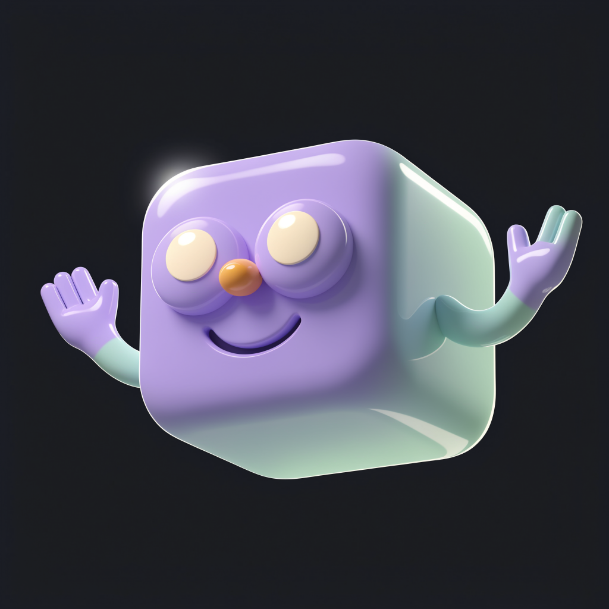

# 🟪 HelperSasny — магазин веселья для Roblox Studio



**HelperSasny** — это набор скриптов для Roblox Studio, которые превращают игру в магазин веселья: в игре появляется приятное меню как в Roblox-магазине — с логотипом, кнопками и анимациями. Нажал кнопку — функция сразу работает на карте.

Просто вставляешь два скрипта и один RemoteEvent, как описано ниже.

---

## ✨ Что умеет (10 функций)

### Твои запросы
| Функция | Что делает |
|---|---|
| 🟥 **Кубик-погонщик** | Неоновый красный кубик с глазами, трейлом и светом гонится за тобой 12 сек и толкает при касании |
| 🔵 **Круг-погонщик** | Синий круг (цилиндр), ускоряется к концу погони |
| 🔺 **Треугольник** | Жёлтый треугольник (WedgePart) летит за тобой |
| 🚀 **Высокий прыжок** | `JumpPower = 160` на 15 секунд — прыгай до небес |
| 👑 **Жирный ник** | Ник над головой жирным шрифтом `GothamBlack`, с обводкой и градиентом, пульсирует |
| 🤕 **Ragdoll на R** | Нажал **R** — персонаж падает как тряпичная кукла (BallSocketConstraint), через 3.5 сек встаёт. Повторный R — встать сразу |

### Бонусы
| Функция | Что делает |
|---|---|
| ⚡ **Скорость x2** | `WalkSpeed = 32` на 10 секунд |
| 🌈 **Радужная аура** | Радужные частицы + цветной свет вокруг персонажа 12 сек |
| 🎉 **Конфетти-вечеринка** | 60 неоновых конфетти + взрыв частиц |
| 🐾 **Гигант** | Стань в 1.7 раз больше на 12 секунд (`ScaleTo`) |

Все функции с кулдауном 2 сек, чтобы нельзя было спамить.

---

## 🖥 СТИКС-ПЕРСОНАЖ (только на вашем клиенте)

При входе в игру персонаж автоматически становится **худым стикманом**, который виден в **полный рост** с зафиксированной камеры — как 2D-картинка на экране. Движение блокируется (ходьба и прыжки отключены, камера зафиксирована). Рядом появляется панель:

- **🍔 Жирнее** — стикман **анимированно становится жирнее и жирнее** (торс расширяется, голова и руки/ноги толщают, счётчик до 10).
- **🥗 Похудеть** — стикман анимированно худеет обратно.
- **✕ Выйти** — выйти из режима: стикман удаляется, персонаж и камера восстанавливаются.

> Режим активируется автоматически при загрузке персонажа. Чтобы выйти — нажми **✕ Выйти**.

---

## 🛠 Установка (2 минуты)

Нужно создать **2 скрипта** в Studio. Папка `HelperSasnyRemotes` и RemoteEvent `UseFunction` создаются **самим сервером автоматически** при старте — ручным созданием заниматься не нужно.

Для каждого скрипта: кликни правой кнопкой → в меню выбора типа (Script / LocalScript) → **Explorer** → выбери нужную папку → вставь код из файла.

> 💡 Серверный скрипт должен запуститься **до** клиентского — он сам создаст папку `ReplicatedStorage/HelperSasnyRemotes` и RemoteEvent `UseFunction`. Клиентscript просто дождётся их появления.

### 📌 Шаг 1. Серверный скрипт

1. В **Explorer** → `ServerScriptService` → правый клик → **Insert Object** → **Script**.
2. Назови скрипт: `HelperSasnyServer`
3. Дважды кликни по скрипту → в editor вставь **весь код из файла `src/Server.lua`**.
4. Сохрани (Ctrl+S).

### 📌 Шаг 2. Клиентский скрипт

1. В **Explorer** → `StarterPlayer` → раскрой `StarterPlayerScripts`.
   - Если `StarterPlayerScripts` нет: в `StarterPlayer` → правый клик → **Insert Object** → **StarterPlayerScripts**.
2. Внутри `StarterPlayerScripts` → правый клик → **Insert Object** → **LocalScript**.
3. Назови скрипт: `HelperSasnyClient`
4. Дважды кликни по скрипту → в editor вставь **весь код из файла `src/Client.lua`**.
5. Сохрани (Ctrl+S).

### 🎮 Игра

1. Нажми **Play** (▶).
2. В игре справа внизу появится круглая кнопка **HS**.
3. Нажми её — откроется магазин.
4. **Кнопки магазина** — каждая активирует функцию на твоём персонаже.
5. **Клавиша R** — мгновенный Ragdoll (можно и без магазина).
6. **Крестик ✕** в шапке — закрыть магазин.

Магазин в фиолетово-мятных цветах логотипа, с анимацией открытия, hover-эффектами и тостами «Активировано!».

---

## 🗂 Структура файлов

```
HelperSasny/
├── logo.png          ← логотип (фиолетовый кубик)
├── README.md         ← эта инструкция
└── src/
    ├── Server.lua    ← сервер: вставить в ServerScriptService как Script "HelperSasnyServer"
    └── Client.lua    ← клиент: вставить в StarterPlayerScripts как LocalScript "HelperSasnyClient"
```

**Что вставить куда — краткая таблица:**

| Файл | Кладём в | Тип | Имя |
|---|---|---|---|
| `src/Server.lua` | `ServerScriptService` | **Script** | `HelperSasnyServer` |
| `src/Client.lua` | `StarterPlayer` → `StarterPlayerScripts` | **LocalScript** | `HelperSasnyClient` |
| (разовый объект) | `ReplicatedStorage` → Folder → **RemoteEvent** | RemoteEvent | `UseFunction` (внутри папки `HelperSasnyRemotes`) |

---

## 🎨 Логотип

Логотип лежит в файле **`logo.png`** — милый фиолетовый кубик с минт-акцентами.

Логотип используется в магазине-меню: кнопка **HS** и задний фон магазина раскрашены в цвета логотипа.

---

## 🗑 Удаление

Просто удалишь три объекта:
1. `ServerScriptService/HelperSasnyServer`
2. `StarterPlayer/StarterPlayerScripts/HelperSasnyClient`
3. `ReplicatedStorage/HelperSasnyRemotes` (вся папка)

---

## 🛠 Технические детали

- **Luau**: сервер — `Script`, клиент — `LocalScript`.
- Погонщики: `Anchored` + `CFrame.lookAt` каждый `Heartbeat`, с `Trail`, `PointLight`, `ParticleEmitter`, глазами.
- Ragdoll: `Humanoid:ChangeState(Physics)` + `BallSocketConstraint` на каждый `Motor6D`, автовосстановление через 3.5 сек.
- Ник: `BillboardGui` + `GothamBlack` + `UIStroke` + `UIGradient`.
- Магазин: `ScreenGui` + `UIGridLayout` + `TweenService`, `ResetOnSpawn = false`.

---

Сделано с 💜 для весёлой игры. Приятной игры!
